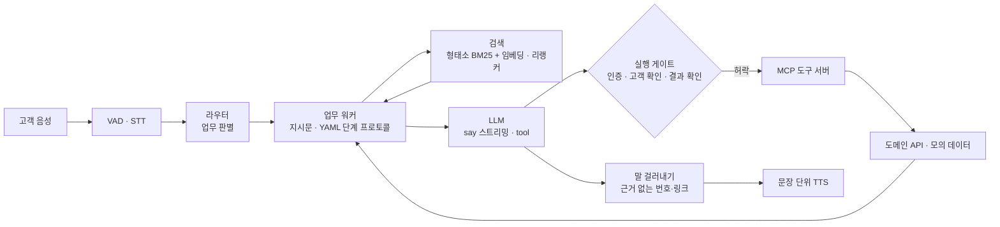
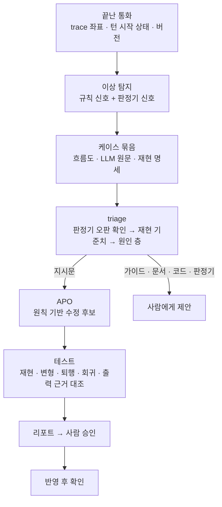

# customer-service-agent

조회·확인·실행까지 상담 업무를 끝까지 수행하는 한국어 상담 에이전트와, 그것을 안전하게 만들고 측정하고 개선하는 체계.
텍스트와 실시간 음성(끼어들기·무응답) 양쪽에서 동작한다. 개인 학습 프로젝트이며 **개발 중**이다.

> ## ⚠️ 비공식 개인 프로젝트
> - **토스(비바리퍼블리카 및 계열사)와 아무 관련이 없는 개인 학습 프로젝트다.** 토스의 공식 서비스·제품이 아니며, 토스의 승인·후원·검토를 받지 않았다.
>   토스 소속이 아닌 개인이 만들었다.
> - 업무 절차는 **누구나 볼 수 있는** 토스 고객센터 FAQ와 토스쇼핑 판매자 문서를 참고해 직접 만든 **모의 상담**이다.
>   실제 상담 절차·내부 정책·내부 시스템과 다를 수 있다.
> - 고객·카드·주문·송금 정보와 도구(정지·분실신고·링크 발송 등)는 **모두 가짜**이며 어떤 실제 시스템에도 연결되지 않는다.
> - **FAQ·문서 원문은 저장소에 포함하지 않는다** (`data/` 제외). 저장소에는 원문에서 확인한 절차·번호 같은 사실과 직접 쓴 시나리오·지시문만 있다.
> - 토스의 로고·디자인 자산은 쓰지 않는다. 「토스」 등 상표는 각 소유자의 것이며, 이 저장소에서는 참고한 공개 문서의 출처를 밝히는 용도로만 쓴다.

## 무엇을 하나

| 업무 | 방향 | 에이전트가 하는 일 |
|---|---|---|
| S1 배송·주문 문의 | 인바운드 | 주문 조회 → 상태·지연 안내, 처리할 수 없는 일은 고객센터·상담원 연결 |
| S3 교환·반품 | 인바운드 | 주문 조회 → 사유·상태별 안내(파손·불량 / 단순 변심 / 발송 전 / 배송 중) → 접수 안내 링크 |
| S4 착오송금 | 인바운드 | 송금 조회 → 사유 분기(실수·거래대금·타인요구) → 접수 링크 또는 사기 의심 시 상담원 연결 |
| S5 카드 분실 | 인바운드 | 카드 조회 → 앱 본인 인증 → 고객 확인 후 일시정지·분실신고 실행 |
| O1 셀러 페널티 사전 안내 | 아웃바운드 | 담당자 확인 → 페널티 현황 안내 → 반발 시 소명 가이드 발송 |

## 구조



- **결정적 워크플로 + LLM**: 진행 순서와 실행 허락은 코드(단계 프로토콜·실행 게이트)가 정하고, LLM은 고객 말 이해와 응답 생성을 맡는다 (`docs/05`)
- **도구 3층**: 에이전트 / MCP 도구 서버 / 도메인 API — 도구 정의(`catalog/`)와 업무 규칙(`csagent/domain/`)이 에이전트 코드와 분리돼 있다 (`docs/08`)
- **오동작 가드레일**: 평가에서 실제로 일어난 실패만 골라 하네스에서 막는다 — 확인 없는 실행, 근거 없는 번호·링크, 시간 초과는 「결과 모름」, 기록은 고객이 **실제로 들은 말** 기준 (`docs/09`)
- **음성**: VAD → STT(Whisper turbo) → 스트리밍 응답 → 문장 단위 TTS(Supertonic). 끼어들기 시 응답 취소, 무응답 감시

## 평가

- **시나리오**: 개발 세트 25개(`scenarios/`) + 보류 세트 8개(`scenarios_heldout/`) — 업무와 고객 행동(정상·말 바꿈·인증 실패·남의 주문 등)의 조합
- **고객 시뮬레이터**(LLM)와 에이전트를 대화시키고 채점한다
  - 규칙 채점: 필수·금지 도구, 마일스톤 순서, 처리 결과, 음성 길이·형식, 반복
  - LLM Judge: 필수 내용 전달, 금지 언행, 목표 해결, 턴별 근거 여부
- **Judge 신뢰도** (`docs/07`): 76통화·501항목 재판정 일관성, 참조 라벨 대비 일치도(무작위 40건 일치 95%, κ 0.72 — 참조 라벨은 사람이 아니라 Claude Opus가 붙였다, 표본이 작아 방향 확인용)
- **근거 판정 v4** (`docs/07` 7-5): 업무 지시문만 바꿔도 판정이 뒤집히는 문제(지시 준수가 사실 판정에 섞임)를 실험으로 확인하고,
  주장 추출 / 근거 대조 2단계 + 인용 원문 코드 대조로 재설계 — 지시문 3개 변형에서 추출 주장 목록 96% 동일, 같은 입력 재판정 흔들림 0

## 관측과 개선 루프



- **좌표와 재현기** (`docs/10` 3·5절): 모든 trace 이벤트에 `t2.s1.gate` 같은 좌표와 턴 시작 상태를 남기고, 기록된 통화의 한 지점부터 N번 다시 돌려 수정 전후 실패 수를 비교한다
- **이상 탐지** (`docs/10` 4절): 끝난 통화에서 신호를 찾아 케이스 묶음을 만든다 — 기준선 50통화에서 채점 실패 5건을 모두 잡았다
- **triage · APO** (`docs/10` 6절): Claude Code 스킬(`.claude/skills/`)이 원인을 6개 층(지시문·가이드·문서·코드·판정기·환경)으로 나누고,
  지시문이 원인이면 프롬프트 작성 원칙에 따라 수정 후보를 만들어 테스트한다. **어느 단계도 저장소를 직접 고치지 않는다** — 반영은 사람이 결정한다
  - 일부러 지시문 한 줄을 지운 결함(정답을 가린 별도 환경): 원인을 찾고, 지운 문장과 사실상 같은 한 줄을 추천, 재현 5/5 → 0/5 · 변형 3개 3/3 → 0/3 · 관련 회귀 퇴행 없음
  - 실제 결함(반복): 후보가 목표 결함은 줄였지만 문서에 없는 내용을 지어내거나 앞 턴 대화부터 돌리면 여전히 반복해, 검증 단계가 추천하지 않았다

## 실행 환경

로컬 GPU 1장(RTX 4090 24GB)과 로컬 모델만 쓴다. 에이전트·평가에 외부 LLM API는 쓰지 않는다 (개선 루프의 분석·제안은 Claude Code).

| 구성 | 사용 |
|---|---|
| LLM | Qwen3.8-27B-INT4 (vLLM) |
| 임베딩·리랭커 | Qwen3-Embedding-0.6B, Qwen3-Reranker-0.6B |
| 벡터 DB | Milvus Lite |
| 형태소 분석 | kiwipiepy |
| 도구 | MCP 도구 서버 + 도메인 API (FastAPI) |
| 서버·웹 | FastAPI, 바닐라 JS (통화·업무 화면·모니터) |
| 음성 | faster-whisper, Supertonic |

```bash
bash scripts/serve.sh start          # 임베딩·리랭커·LLM·음성 + 도메인 API(8020)·도구 서버(8021)
python scripts/collect_toss.py       # 공개 문서 수집 → data/raw/ (저장소에 올리지 않음)
python scripts/build_index.py        # 정제·청크·색인
python scripts/run_server.py         # 웹 (http://<IP>:8080)
python -m pytest -q                  # 테스트

python scripts/run_eval.py --agent C --only s5_ o1_h6 --repeat 2    # 평가 (일부 시나리오)
python scripts/detect.py runs/<실행>                                # 이상 탐지 → runs/cases/
python scripts/repro.py runs/<실행>/<시나리오>:0 --at t3 --mode turn --repeat 5 --fail repeat=true   # 재현
python scripts/case_report.py runs/cases/<시각>/<케이스>            # 케이스 리포트
```

`collect_toss.py`는 공개 페이지를 개인 학습용으로 받아 로컬에만 저장한다. 받은 원문은 다시 배포하지 않는다.

## 진행 상황

| 항목 | 상태 |
|---|---|
| 데이터 정제·색인, 하이브리드 검색 | 완료 |
| 에이전트: S1·S3·S4·S5·O1 | 완료 |
| 도구 3층 분리 (MCP 도구 서버·도메인 API) | 완료 |
| 오동작 가드레일 G1~G9 | 완료 |
| 평가 파이프라인 (시뮬레이터·규칙 채점·LLM Judge) | 완료 |
| Judge 신뢰도·근거 판정 v4 | 완료 |
| 관측(좌표·상태·버전)·재현기·이상 탐지 | 완료 |
| 개선 루프 (triage·APO 스킬, 테스트 실행기, 리포트, 케이스 모음) | 구현·시험 (라운드 자동 반복은 개발 중) |
| 실시간 음성 통화 | 구현 (실제 마이크 통화 검증 전) |
| 첫 소리 지연 (약 3~6초) | 개선 전 |

## 문서

| 문서 | 내용 |
|---|---|
| `docs/04_에이전트_구조_검토.md`, `docs/05_에이전트_구조_설명.md` | 구조 후보 비교, 결정적 워크플로 + LLM을 고른 이유 |
| `docs/07_실험_Judge_신뢰도.md` | 판정기 일관성·일치도, 지시문 민감도, 근거 판정 v4 |
| `docs/08_도구_구조_설계.md` | 도구 3층 분리 설계와 구현 기록 |
| `docs/09_오동작_가드레일.md` | 가드레일 후보·선별 이유·적용과 확인 |
| `docs/10_관측과_재현.md` | 좌표·재현기·이상 탐지·개선 루프(triage·APO)와 실험 |
